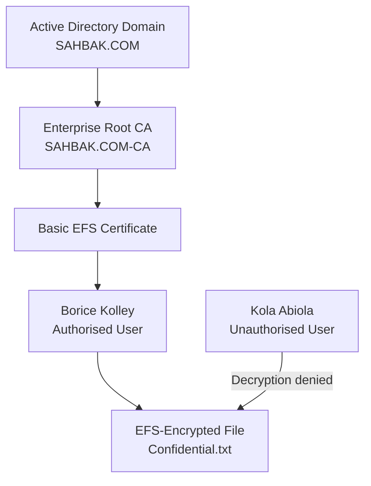

<h1>🔐 On-Premises AD CS & EFS File Encryption Project</h1>

<h3>Enterprise PKI, Certificate Enrolment and Cryptographic File Protection</h3>

  
  
  
  
  
  

<h3>📌 Project Overview</h3>

This project demonstrates the deployment of an internal Public Key Infrastructure using Microsoft Active Directory Certificate Services on Windows Server 2022.

The project was built within the simulated <strong>Sahbak Active Directory environment</strong> to demonstrate how domain identities, digital certificates, public and private keys, and the Windows Encrypting File System work together to protect sensitive files.

An <strong>Enterprise Root Certification Authority</strong> was deployed and integrated with the <code>SAHBAK.COM</code> domain. The <strong>Basic EFS</strong> certificate template was published, an EFS certificate was enrolled for an authorised domain user, and a confidential test file was encrypted on a domain-joined Windows client.

Access was then tested using a second authenticated domain user who did not possess the authorised user’s EFS certificate and private key.

> **Scope:** This is an educational laboratory project demonstrating foundational PKI, certificate-management and EFS concepts. It is not presented as a production PKI design or a claim of regulatory compliance.

<h3>🎯 Project Objectives</h3>

<ul>
  <li>Deploy an Enterprise Root CA using Active Directory Certificate Services,</li>
  <li>Establish an internal PKI trust foundation,</li>
  <li>Integrate the Certification Authority with Active Directory,</li>
  <li>Publish an EFS-capable certificate template,</li>
  <li>Enrol an EFS certificate for an authorised domain user,</li>
  <li>Encrypt a confidential test file using Windows EFS,</li>
  <li>Verify the certificate authorised to decrypt the file,</li>
  <li>Confirm that another authenticated user cannot decrypt the file and,</li>
  <li>Demonstrate the relationship between identity, certificates, cryptographic keys and access control.</li>
</ul>

<h3>🧪 Lab Environment</h3>

Exact server IP addresses and machine-generated hostnames have been removed from this public documentation.

<table>
  <thead>
    <tr>
      <th>Component</th>
      <th>Configuration</th>
    </tr>
  </thead>
  <tbody>
    <tr>
      <td>Organisation</td>
      <td>Sahbak</td>
    </tr>
    <tr>
      <td>Active Directory domain</td>
      <td><code>SAHBAK.COM</code></td>
    </tr>
    <tr>
      <td>Certification Authority</td>
      <td><code>SAHBAK.COM-CA</code></td>
    </tr>
    <tr>
      <td>CA server</td>
      <td>Internal Windows Server 2022 server</td>
    </tr>
    <tr>
      <td>Server IP address</td>
      <td>Redacted</td>
    </tr>
    <tr>
      <td>CA type</td>
      <td>Enterprise Root CA</td>
    </tr>
    <tr>
      <td>Cryptography</td>
      <td>RSA 2048-bit key with SHA-256</td>
    </tr>
    <tr>
      <td>Certificate template</td>
      <td>Basic EFS</td>
    </tr>
    <tr>
      <td>Client operating system</td>
      <td>Windows 8.1 Pro</td>
    </tr>
    <tr>
      <td>Client device</td>
      <td>Domain-joined workstation</td>
    </tr>
    <tr>
      <td>Test file</td>
      <td><code>C:\EFS-Test\Confidential.txt</code></td>
    </tr>
  </tbody>
</table>

<h3>👥 Test Identities</h3>

<table>
  <thead>
    <tr>
      <th>User</th>
      <th>Role in the Test</th>
    </tr>
  </thead>
  <tbody>
    <tr>
      <td><strong>Borice Kolley</strong></td>
      <td>Authorised EFS certificate holder and encrypted-file owner</td>
    </tr>
    <tr>
      <td><strong>Kola Abiola</strong></td>
      <td>Authenticated domain user without Borice Kolley’s EFS private key</td>
    </tr>
  </tbody>
</table>

The identities used in this project were created specifically for the simulated laboratory environment.

<h3>🏗️ Architecture</h3>

<h3>⚙️ Project Implementation</h3>

<h4>1. Deploy Active Directory Certificate Services</h4>

The Active Directory Certificate Services server role was installed on Windows Server 2022.

The server was configured as an <strong>Enterprise Root CA</strong>, enabling integration with Active Directory identities and certificate templates.

<h4>2. Configure the Certification Authority</h4>

The Certification Authority was configured with the following common name:

<pre><code>SAHBAK.COM-CA</code></pre>

A new RSA private key was generated using a 2048-bit key length and the SHA-256 hashing algorithm. The CA became the internal trust anchor for certificates issued within the Sahbak laboratory environment.

<h4>3. Publish the EFS Certificate Template</h4>

The built-in <strong>Basic EFS</strong> certificate template was enabled and published through the Certification Authority.

This allowed eligible domain users to request certificates intended for Windows Encrypting File System operations.

<h4>4. Enrol the Authorised User</h4>

Borice Kolley signed in to the domain-joined Windows client and enrolled for an EFS certificate.

The issued certificate and its associated private key were stored within Borice’s Windows user profile.

<h4>5. Create the Confidential Test File</h4>

The following test file was created:

<pre><code>C:\EFS-Test\Confidential.txt</code></pre>

The file contained simulated confidential information created solely for the laboratory test.

<h4>6. Encrypt the Test File</h4>

EFS encryption was enabled using:

<pre><code>Properties → Advanced → Encrypt contents to secure data</code></pre>

The filename appeared green in Windows File Explorer, providing a visual indication that EFS encryption was active.

<h4>7. Verify the Encryption</h4>

The following command was executed while signed in as Borice:

<pre><code>cipher /c C:\EFS-Test\Confidential.txt</code></pre>

The output confirmed that:

<ul>
  <li>The file was encrypted,</li>
  <li>An EFS certificate protected the file,</li>
  <li>Borice Kolley was listed under <strong>Users who can decrypt</strong> and,</li>
  <li>Decryption required the corresponding EFS private key.</li>
</ul>

Certificate thumbprints were redacted from publicly available evidence.

<h4>8. Test Unauthorised Access</h4>

The Windows client session was switched to Kola Abiola.

Kola was a valid authenticated domain user but did not possess Borice’s EFS certificate and private key.

Attempts to open the encrypted file produced an <strong>Access is denied</strong> message. This confirmed that successful domain authentication did not provide the cryptographic capability required to decrypt the file.

The following commands were used during the test:

<pre><code>whoami
cipher /c C:\EFS-Test\Confidential.txt</code></pre>

<h3>✅ Validation Results</h3>

<table>
  <thead>
    <tr>
      <th>Test</th>
      <th>Expected Result</th>
      <th>Outcome</th>
    </tr>
  </thead>
  <tbody>
    <tr>
      <td>Borice opens <code>Confidential.txt</code></td>
      <td>File opens and remains readable</td>
      <td><strong>PASS</strong></td>
    </tr>
    <tr>
      <td>Borice runs <code>cipher /c</code></td>
      <td>Encryption and certificate information are displayed</td>
      <td><strong>PASS</strong></td>
    </tr>
    <tr>
      <td>Kola attempts to open the file</td>
      <td>Access is denied</td>
      <td><strong>PASS</strong></td>
    </tr>
    <tr>
      <td>Kola copies and opens the file</td>
      <td>Copied file remains encrypted and unreadable</td>
      <td><strong>PASS</strong></td>
    </tr>
    <tr>
      <td>Kola runs <code>cipher /c</code></td>
      <td>Borice is listed as the authorised certificate holder</td>
      <td><strong>PASS</strong></td>
    </tr>
  </tbody>
</table>

<h3>🔑 How EFS Protects the File</h3>

<ol>
  <li>Windows generates a random symmetric <strong>File Encryption Key</strong>,</li>
  <li>The File Encryption Key encrypts the contents of the file,</li>
  <li>EFS protects the File Encryption Key using the public key in Borice’s EFS certificate,</li>
  <li>The protected File Encryption Key is stored with the encrypted file in a Data Decryption Field,</li>
  <li>Borice’s private key recovers the File Encryption Key when the file is opened,</li>
  <li>The File Encryption Key decrypts the contents of the file and,</li>
  <li>Kola cannot recover the File Encryption Key because Kola does not possess Borice’s private key.</li>
</ol>

<h3>🛡️ EFS and NTFS Permissions</h3>

<table>
  <thead>
    <tr>
      <th>Security Control</th>
      <th>Purpose</th>
    </tr>
  </thead>
  <tbody>
    <tr>
      <td>NTFS permissions</td>
      <td>Determine which identities may access files and folders</td>
    </tr>
    <tr>
      <td>EFS encryption</td>
      <td>Cryptographically protects the contents of a file</td>
    </tr>
    <tr>
      <td>EFS certificate</td>
      <td>Associates an authorised identity with an encryption public key</td>
    </tr>
    <tr>
      <td>EFS private key</td>
      <td>Provides the cryptographic capability required to decrypt the file</td>
    </tr>
    <tr>
      <td>Data Recovery Agent</td>
      <td>Provides authorised recovery capability when properly configured</td>
    </tr>
  </tbody>
</table>

<ul>
  <li>NTFS permissions and EFS encryption provide different layers of protection,</li>
  <li>File ownership does not automatically provide the required private key,</li>
  <li>Administrative permissions do not automatically decrypt an EFS-protected file,</li>
  <li>Decryption requires an authorised private key or configured Data Recovery Agent and,</li>
  <li>Copying the encrypted file does not automatically remove its cryptographic protection.</li>
</ul>

<h3>🔐 Security Principles Demonstrated</h3>

<ul>
  <li>Enterprise Public Key Infrastructure,</li>
  <li>Certificate-based trust,</li>
  <li>Identity binding,</li>
  <li>Public and private key cryptography,</li>
  <li>Symmetric file encryption,</li>
  <li>File-level data confidentiality,</li>
  <li>Cryptographic access control,</li>
  <li>Separation of authentication and decryption rights,</li>
  <li>Least privilege,</li>
  <li>Defence in depth and,</li>
  <li>Certificate and private-key lifecycle awareness.</li>
</ul>

<h3>🧰 Tools and Technologies</h3>

<ul>
  <li>Windows Server 2022,</li>
  <li>Active Directory Domain Services,</li>
  <li>Active Directory Certificate Services,</li>
  <li>Certification Authority console (<code>certsrv.msc</code>),</li>
  <li>Certificate Templates console (<code>certtmpl.msc</code>),</li>
  <li>Microsoft Management Console,</li>
  <li>Certificates snap-in,</li>
  <li>Active Directory Users and Computers,</li>
  <li>Windows 8.1 Pro,</li>
  <li>Encrypting File System,</li>
  <li>NTFS and,</li>
  <li>Windows <code>cipher</code> utility.</li>
</ul>

<h3>🧠 Key Learning Outcomes</h3>

This project provided practical experience in deploying an Enterprise Root Certification Authority, publishing a certificate template, enrolling a user certificate, and applying certificate-based file encryption.

It demonstrated that Active Directory authentication, NTFS permissions, certificate ownership, and possession of a private key are separate but closely connected security controls.

The access tests demonstrated how EFS can maintain file confidentiality even when another authenticated domain user can locate or copy an encrypted file.

<h3>🚀 Recommended Next Phases</h3>

<ul>
  <li>Configure an EFS Data Recovery Agent,</li>
  <li>Enable certificate auto-enrolment through Group Policy,</li>
  <li>Test certificate revocation,</li>
  <li>Publish and validate Certificate Revocation Lists,</li>
  <li>Document certificate renewal procedures,</li>
  <li>Export and securely back up EFS certificates and private keys,</li>
  <li>Test certificate expiration and replacement,</li>
  <li>Extend the PKI to support TLS,</li>
  <li>Explore S/MIME email protection and,</li>
  <li>Explore certificate-based authentication.</li>
</ul>

<h3>📚 References</h3>

<ul>
  <li><a href="https://learn.microsoft.com/en-us/windows-server/identity/ad-cs/active-directory-certificate-services-overview">Microsoft Learn — Active Directory Certificate Services overview</a></li>
  <li><a href="https://learn.microsoft.com/en-us/windows-server/administration/windows-commands/cipher">Microsoft Learn — cipher command</a></li>
  <li><a href="https://www.nist.gov/cyberframework">NIST Cybersecurity Framework</a></li>
  <li><a href="https://www.iso.org/standard/27001">ISO 27001 Information Security Management Systems</a></li>
</ul>

<h3>⚠️ Evidence and Privacy Notice</h3>

Screenshots captured directly from the laboratory should be used wherever available.

Any recreated or sanitised visual should be clearly labelled <strong>Reconstruction</strong>, <strong>Sanitised Documentation View</strong>, or <strong>Illustrative Output</strong>. It should not be presented as an untouched live screenshot.

The following information should be removed before public publication:

<ul>
  <li>Exact internal IP addresses,</li>
  <li>Machine-generated server hostnames,</li>
  <li>Certificate thumbprints,</li>
  <li>Private keys,</li>
  <li>Passwords,</li>
  <li>Authentication secrets and,</li>
  <li>Recovery keys.</li>
</ul>

<h3>⚠️ Disclaimer</h3>

This project was created for educational and professional portfolio purposes within a controlled virtual laboratory. The organisation, domain, users, files and configurations shown are simulated.

No genuine confidential information, production credentials or organisational data are included.

<h3>👤 Author</h3>

<strong>Saheed Bakare</strong> 
IT Support Engineer | Cybersecurity & IAM Practitioner

