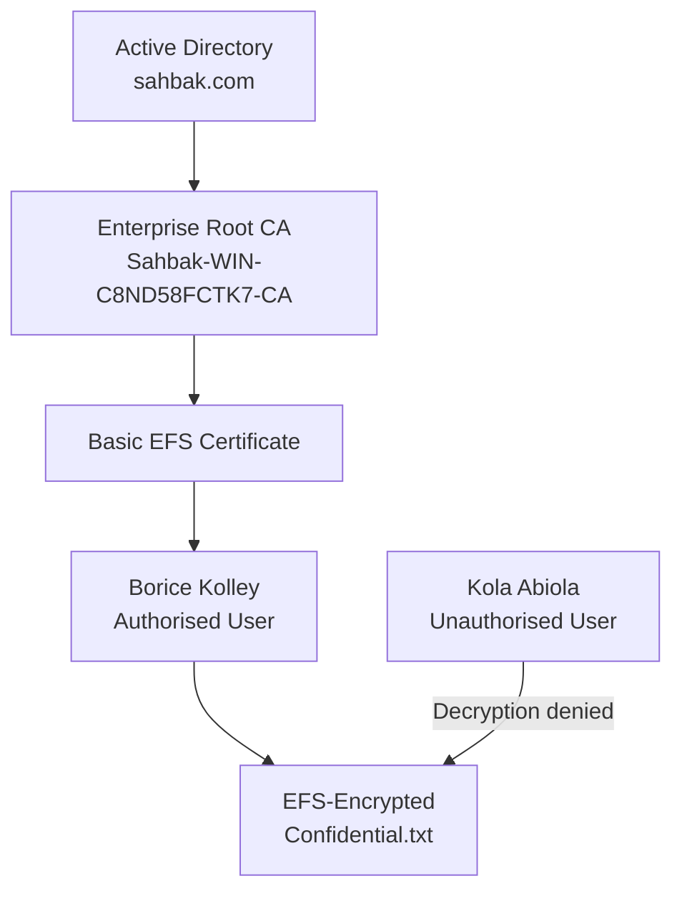

# On-Premises AD CS & EFS File Encryption Project

### Enterprise PKI, Certificate Enrolment and Cryptographic File Protection

## Overview

This project demonstrates the deployment of an internal Public Key Infrastructure (PKI) using Microsoft Active Directory Certificate Services (AD CS) on Windows Server 2022. It was built in the simulated **Sahbak** Active Directory environment to show how domain identities, digital certificates, public/private key cryptography and the Windows Encrypting File System (EFS) work together to protect sensitive data.

An **Enterprise Root Certification Authority** was deployed in the `sahbak.com` domain. The **Basic EFS** certificate template was published, an EFS certificate was enrolled for an authorised domain user and a test file was encrypted on a domain-joined Windows client.

Access was then tested with a second authenticated domain user who did not possess the required private key.

> **Scope:** This is an educational lab demonstrating foundational PKI and EFS concepts. It is not presented as a production PKI design or a claim of regulatory compliance.

## Project Objectives

- Deploy an Enterprise Root CA using AD CS.
- Establish an internal PKI trust foundation in Active Directory.
- Publish and use an EFS-capable certificate template.
- Enrol an EFS certificate for an authorised domain user.
- Encrypt and verify a confidential test file using EFS.
- Confirm that another domain user cannot decrypt the file.
- Demonstrate the relationship between identity, certificates, cryptographic keys and access control.

## Lab Environment

| Component | Configuration |
|---|---|
| Organisation | Sahbak |
| Active Directory domain | `sahbak.com` |
| CA server | `WIN-C8ND58FCTK7` |
| CA server FQDN | `WIN-C8ND58FCTK7.Sahbak.com` |
| CA server IPv4 address | `192.168.30.10` |
| Server operating system | Windows Server 2022 |
| CA type | Enterprise Root CA |
| CA common name | `Sahbak-WIN-C8ND58FCTK7-CA` |
| Cryptography | RSA 2048-bit key with SHA-256 |
| Certificate template | Basic EFS |
| Client | Windows 8.1 Pro (`AuditPC1`) |
| Test file | `C:\EFS-Test\Confidential.txt` |

## Test Identities

| User | Role in the Test |
|---|---|
| **Borice Kolley** | Authorised EFS certificate holder and encrypted-file owner |
| **Kola Abiola** | Authenticated domain user without Borice Kolley’s EFS private key |

## Architecture



## Implementation

### 1. Deploy Active Directory Certificate Services

The AD CS role was installed on Windows Server 2022. The server was configured as an **Enterprise Root CA**, enabling integration with Active Directory identities and certificate templates.

### 2. Configure the Certification Authority

The CA was configured with the common name:

```text
Sahbak-WIN-C8ND58FCTK7-CA
```

A new RSA private key was generated using a 2048-bit key length and SHA-256 hashing. The CA became the internal trust anchor for certificates issued within the Sahbak lab.

### 3. Publish the EFS Certificate Template

The built-in **Basic EFS** certificate template was enabled on the CA. This allowed eligible domain users to request certificates intended for Encrypting File System operations.

### 4. Enrol the Authorised User

Borice Kolley signed in to the domain-joined Windows client and enrolled for an EFS certificate. The certificate and associated private key were stored in Borice’s user profile.

### 5. Encrypt the Test File

Borice created the following test file:

```text
C:\EFS-Test\Confidential.txt
```

Encryption was enabled by selecting:

```text
Properties → Advanced → Encrypt contents to secure data
```

The filename appeared green in File Explorer, providing a visual indication that EFS encryption was active.

### 6. Verify the Encryption

The following command was run while signed in as Borice:

```cmd
cipher /c C:\EFS-Test\Confidential.txt
```

The output confirmed that the file was encrypted and listed Borice Kolley’s certificate under **Users who can decrypt**.

Certificate thumbprints should be redacted before screenshots are published publicly.

### 7. Test Unauthorised Access

The client session was switched to **Kola Abiola**. Kola was a valid domain user but did not possess Borice’s EFS private key.

Attempts to open the encrypted file produced an **Access is denied** message. This confirmed that successful domain authentication alone did not provide the cryptographic capability required to decrypt the file.

The following commands were used to confirm the active user and inspect the file:

```cmd
whoami
cipher /c C:\EFS-Test\Confidential.txt
```

## Validation Results

| Test | Expected Result | Outcome |
|---|---|---|
| Borice opens `Confidential.txt` | File opens and is readable | **PASS** |
| File inspected using `cipher /c` | Encryption and certificate information are displayed | **PASS** |
| Kola opens `Confidential.txt` | Access is denied | **PASS** |
| Kola copies and opens the file | Copied file remains encrypted and cannot be opened | **PASS** |
| Kola runs `cipher /c` | Borice is listed as the authorised certificate holder | **PASS** |

## How EFS Protects the File

1. Windows generates a random symmetric **File Encryption Key (FEK)**.
2. The FEK encrypts the contents of the file.
3. EFS protects the FEK using the public key in Borice’s EFS certificate.
4. The protected FEK is stored with the file in a Data Decryption Field.
5. Borice’s private key recovers the FEK when the file is opened.
6. Kola cannot recover the FEK because Kola does not possess Borice’s private key.

## EFS and NTFS Permissions

- **NTFS permissions** use access control lists to determine which identities may access files and folders.
- **EFS** cryptographically protects the contents of the file.
- File ownership or administrative permissions do not automatically provide the private key required for EFS decryption.
- Decryption requires an authorised EFS certificate and private key, or a configured Data Recovery Agent.

## Security Principles Demonstrated

- Enterprise Public Key Infrastructure
- Certificate-based trust
- Identity binding
- Public/private key cryptography
- File-level data confidentiality
- Cryptographic access control
- Separation of authentication and decryption rights
- Least privilege
- Defence in depth
- Certificate and private-key lifecycle awareness

## Tools and Technologies

- Windows Server 2022
- Active Directory Domain Services
- Active Directory Certificate Services
- Certification Authority console (`certsrv.msc`)
- Certificate Templates console (`certtmpl.msc`)
- Microsoft Management Console
- Certificates snap-in
- Windows 8.1 Pro
- Encrypting File System
- NTFS
- Windows `cipher` utility
- Active Directory Users and Computers

## Evidence Integrity

Screenshots captured directly from the lab should be used wherever available.

Any recreated or sanitised visual must be clearly labelled **Reconstruction**, **Sanitised Documentation View** or **Illustrative Output**. It must not be presented as an untouched live screenshot.

Sensitive certificate thumbprints may be redacted before evidence is published in the public repository.

## Key Learning Outcomes

This project provided practical experience in deploying an Enterprise Root CA, publishing a certificate template, enrolling a user certificate and applying certificate-based file encryption.

It also demonstrated that Active Directory authentication, NTFS permissions, certificate ownership and possession of a private key are separate but closely connected security controls.

The access tests showed how EFS can maintain file confidentiality even when another authenticated domain user can locate or copy the encrypted file.

## Recommended Next Phases

- Configure an EFS Data Recovery Agent.
- Enable certificate auto-enrolment through Group Policy.
- Test certificate revocation and Certificate Revocation Lists.
- Document certificate renewal and lifecycle management.
- Export and securely back up EFS certificates and private keys.
- Extend the PKI to support TLS, S/MIME or smart-card authentication.

## References

- [Microsoft Learn — Active Directory Certificate Services overview](https://learn.microsoft.com/en-us/windows-server/identity/ad-cs/active-directory-certificate-services-overview)
- [Microsoft Learn — cipher command](https://learn.microsoft.com/en-us/windows-server/administration/windows-commands/cipher)
- [NIST Cybersecurity Framework](https://www.nist.gov/cyberframework)
- [ISO/IEC 27001 Information Security Management Systems](https://www.iso.org/standard/27001)
